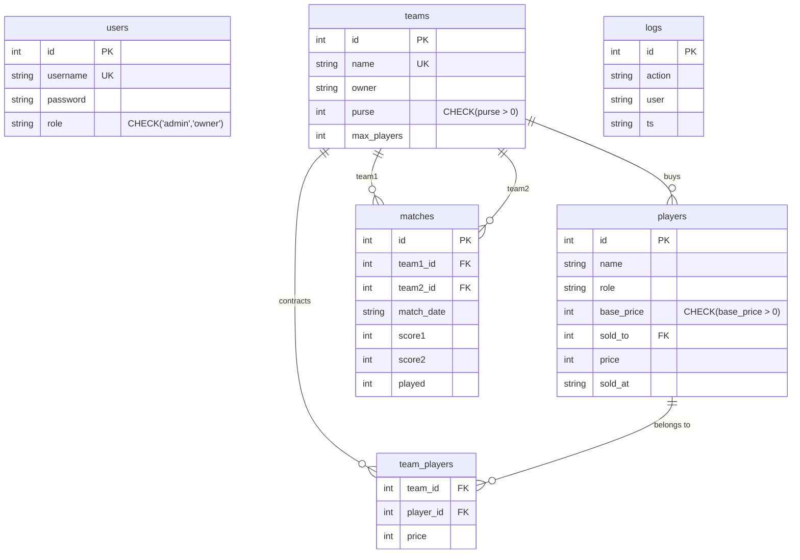

# 🏆 Tournament Management System — Project & Presentation Guide

> **Comprehensive Technical Documentation & Class Presentation Handbook**  
> *Prepared for team project evaluation, architecture review, and live classroom presentation.*

---

## 📑 Table of Contents
1. [Executive Summary & Project Overview](#1-executive-summary--project-overview)
2. [High-Level Architecture](#2-high-level-architecture)
3. [Exhaustive File-by-File Breakdown (All 27 Files)](#3-exhaustive-file-by-file-breakdown)
4. [Deep Dive into Core Engineering Components](#4-deep-dive-into-core-engineering-components)
   - [Object-Oriented Relationships (Association, Aggregation, Composition)](#a-object-oriented-relationships)
   - [Auction Engine & Transaction Integrity](#b-auction-engine--transaction-integrity)
   - [Round-Robin Match Scheduling Algorithm](#c-round-robin-match-scheduling-algorithm)
   - [Complex SQL Points Table & Lambda Re-Sort](#d-complex-sql-points-table--lambda-re-sort)
   - [Stacked Decorator Infrastructure (Security, Timing, Auditing)](#e-stacked-decorator-infrastructure)
5. [Database Schema & Entity Relationship](#5-database-schema--entity-relationship)
6. [Mapping of All 20 Course Concepts](#6-mapping-of-all-20-course-concepts)
7. [Step-by-Step Classroom Presentation Script & Demo Flow](#7-step-by-step-classroom-presentation-script--demo-flow)
8. [Viva & Evaluator Q&A Preparation](#8-viva--evaluator-qa-preparation)

---

## 1. Executive Summary & Project Overview

The **Tournament Management System** is an end-to-end sports league management platform designed to automate franchise administration, athlete auctioning, schedule coordination, live result logging, and standings computation.

### Key Highlights:
- **Dual Interface**: Full feature parity across both an interactive **Terminal CLI** (powered by Python 3.10+ `match-case`) and a responsive **Flask Web Application** (pure HTML5/CSS3 and Jinja2).
- **Zero Third-Party Bloat**: Built purely using the Python standard library, SQLite3, and Flask. No heavy ORMs (like SQLAlchemy), no authentication packages (like Flask-Login), and no CSS/JS frameworks.
- **Relational Integrity**: Enforced through foreign keys, check constraints, ACID transactions, and parameterized SQL queries to prevent SQL injection.
- **Strict Architecture**: Demonstrates foundational Computer Science concepts including 3 classic OOP relationships, recursion, higher-order functions/decorators, lambda expressions, and relational aggregation.

---

## 2. High-Level Architecture

The system follows a clean **Layered Architecture (Model-View-Controller pattern)** separating data persistence, domain logic, and presentation interfaces:

```mermaid
graph TD
    subgraph Presentation_Layer [Presentation Layer]
        CLI[Terminal CLI - main.py]
        Web[Flask Web App - app.py]
        Templates[Jinja2 HTML Templates]
        CSS[Vanilla CSS - static/style.css]
        Web --> Templates
        Templates --> CSS
    end

    subgraph Security_and_Decorators [Cross-Cutting Concerns]
        Dec[@login_required / @web_login_required]
        Admin[@admin_only / @web_admin_only]
        Audit[@log_action -> actions.log]
        Timer[@timer -> Execution Timing]
    end

    subgraph Business_Logic_Layer [Business Logic & Operations]
        Auth[auth.py - Auth & Session]
        Players[players.py - Roster Management]
        Teams[teams.py - Franchise Management]
        Auction[auction.py - Bidding & Purse Engine]
        Matches[matches.py - Fixture Generator & Results]
        Standings[standings.py - SQL Aggregates & Ranking]
        Reports[reports.py - JSON/CSV & Recursion]
        Utils[utils.py - Helpers & Formatting]
        Models[models.py - OOP Entities]
    end

    subgraph Data_Layer [Data Persistence Layer]
        DBConn[db.py - SQLite Connection & Pragma]
        SQLite[(tournament.db)]
        DBConn --> SQLite
    end

    CLI --> Security_and_Decorators
    Web --> Security_and_Decorators
    Security_and_Decorators --> Business_Logic_Layer
    Business_Logic_Layer --> DBConn
```

---

## 3. Exhaustive File-by-File Breakdown

The project consists of exactly 27 files in the `tournament/` package, organized into logical modules:

### ⚙️ Core Configuration & Database
| File | Purpose & Role | Key Functions / Details |
|---|---|---|
| **`requirements.txt`** | Dependency specification. | Declares `Flask>=3.0` as the sole external dependency. |
| **`db.py`** | SQLite connection manager & schema initializer. | `get_conn()`: Returns SQLite connection with `row_factory = sqlite3.Row` and `PRAGMA foreign_keys = ON;`.<br>`init_db()`: Executes idempotent `CREATE TABLE IF NOT EXISTS` for all 6 tables. |
| **`seed.py`** | Pre-populates the system with demo data. | Injects default `admin`/`admin` and `owner`/`owner` credentials, 3 franchise teams with purse budgets ($1000, $900, $800), and 8 players across diverse roles. |

### 🛡️ Security, Decorators & Authentication
| File | Purpose & Role | Key Functions / Details |
|---|---|---|
| **`decorators.py`** | Reusable aspect-oriented decorators. | `@login_required` & `@admin_only`: Guard CLI actions against unauthenticated or unauthorized users.<br>`@web_login_required` & `@web_admin_only`: Inspect Flask session and perform redirect/flash.<br>`@log_action`: Writes timestamp, user, and function name to `actions.log`.<br>`@timer`: Computes `time.time()` elapsed delta. |
| **`auth.py`** | Authentication engine & session tracking. | `current_user`: Global dictionary tracking CLI user state.<br>`check_login(u, p)`: Parameterized credential verification.<br>`create_user(u, p, r)`: Inserts new user with role checks.<br>`login()`, `register()`: Interactive terminal input handlers. |

### 🧱 Domain Models & Utilities
| File | Purpose & Role | Key Functions / Details |
|---|---|---|
| **`models.py`** | OOP domain models & relationships. | `Player`: Athlete entity.<br>`Team`: Aggregates players (`self.players = []`).<br>`Match`: Fixture entity with scores and status.<br>`Tournament`: Composes matches (`self.matches = []`). |
| **`utils.py`** | Formatting, data types & functional helpers. | `format_currency(n)`: Formats numbers with f-strings and `.format()`.<br>`unique_roles(players)`: Extracts distinct player roles into a `set`.<br>`rank_rows(rows)`: Higher-order sorting using `lambda`.<br>Demonstrates the 4 function signatures and arithmetic operators (`+=`, `//`, `%).` |

### ⚡ Business Operations & Game Mechanics
| File | Purpose & Role | Key Functions / Details |
|---|---|---|
| **`players.py`** | Athlete registration and listing. | `add_player()`: Decorated CLI registration with `@login_required`, `@admin_only`, `@log_action`, `@timer`.<br>`list_players()`: `SELECT` with `LEFT JOIN` on teams.<br>`add_player_web()`: Web endpoint handler. |
| **`teams.py`** | Franchise creation and inspection. | `create_team()`: Decorated CLI creation.<br>`list_teams()`: Queries franchise records.<br>`get_team()`: Fetches franchise details.<br>`create_team_web()`: Web handler catching `UNIQUE` constraints. |
| **`auction.py`** | Bidding engine and accounting. | `log_bid(*bids, **meta)`: Demonstrates `*args` and `**kwargs`.<br>`sell_player()`: Atomic multi-table validation (checks purse $\ge$ bid and squad size $<$ cap; updates `team_players`, `players`, and deducts `purse`).<br>`start_auction()`: Interactive CLI loop (`while True`, `break`, `continue`, `pass`).<br>`next_unsold()`, `place_bid()`, `recent_bids()`. |
| **`matches.py`** | Scheduling and score recording. | `generate_matches()`: Round-robin pairing using nested loops, `random.shuffle`, and `datetime.timedelta`.<br>`enter_result()`: CLI score input.<br>`list_matches()`: `JOIN` query with team names.<br>`enter_result_web()`: Web score updater. |
| **`standings.py`** | Leaderboard computation. | `show_points_table()`: Runs exact analytical SQL (`JOIN`, `GROUP BY`, `HAVING`, `CASE WHEN`), re-sorted in Python using `lambda r: (-r[4], -r[2], r[0])`.<br>`get_stats()`: Aggregates total players, teams, and played matches. |
| **`reports.py`** | Serialization & recursive traversal. | `export_json()`: Serializes database state via `json.dump()`.<br>`export_csv()`: Exports leaderboard via `csv.writer()`.<br>`recursive_report()`: Recursive tree walk visiting Teams $\rightarrow$ Squad Players. |

### 🖥️ User Interfaces (CLI & Web)
| File | Purpose & Role | Key Functions / Details |
|---|---|---|
| **`main.py`** | Command-Line Interface controller. | Entry point for CLI. Contains `main()` loop with Python 3.10+ `match-case` evaluating user menu choices 0 through 10. |
| **`app.py`** | Flask Web Application controller. | Defines routes for authentication, dashboard, CRUD operations, live bidding, match scoring, and report file downloads (`send_file`). |

### 🎨 Web Templates & Stylesheet
| File | Purpose & Role | Key Highlights |
|---|---|---|
| **`templates/base.html`** | Master layout template. | Contains navigation bar, authenticated user badge, logout link, flash notification container, and ``. |
| **`templates/login.html`** | User authentication view. | Clean card containing username/password form and registration redirection link. |
| **`templates/register.html`** | Account creation view. | Form allowing registration as either `owner` or `admin`. |
| **`templates/dashboard.html`** | Overview metrics panel. | Displays 3 stat counter cards (Players, Teams, Played Matches) and quick-action navigation buttons. |
| **`templates/players.html`** | Player roster directory. | Table with sold/unsold status badges; conditional admin form to add new players. |
| **`templates/teams.html`** | Franchise list. | Table showing owners, remaining purse budgets, and squad limits; conditional admin team creation form. |
| **`templates/auction.html`** | Live bidding arena. | Split-screen interface: unsold player highlight card with team selection bidding form on left; table of 10 most recent auction sales on right. |
| **`templates/matches.html`** | Fixtures schedule. | Full fixture schedule with status indicators; inline score input fields (`Score 1 - Score 2`) with Save button for unplayed matches. |
| **`templates/standings.html`** | Points leaderboard. | Ranked standings table; leader highlighted with green background (`leader-row`); points badge; rules legend. |
| **`templates/reports.html`** | Export & download center. | One-click button to trigger exports; direct download links for `report.json` and `points.csv`. |
| **`static/style.css`** | Pure CSS3 design system (~85 lines). | Navy header (`#1e3a8a`), clean cards, responsive data tables, badge states, and alert toasts. Completely free of external CSS frameworks. |
| **`README.md`** | Official project documentation. | Setup instructions, run commands, demo flow, and course concept map table. |

---

## 4. Deep Dive into Core Engineering Components

### A. Object-Oriented Relationships
The system explicitly demonstrates the 3 major object-oriented relationships in [models.py](file:///home/ambadi/Documents/Projects/Tournament_management/tournament/models.py):

1. **Association (`Auction` $\leftrightarrow$ `Team`)**:
   - The Auction interacts with Team entities to read budgets and assign players, but neither owns the lifecycle of the other. They are independent entities collaborating.
2. **Aggregation (`Team` has-a `Player`)**:
   - `Team.players = []` holds references to `Player` objects.
   - *Weak ownership*: If a team franchise dissolves or releases players, the `Player` object still exists independently in the player pool.
3. **Composition (`Tournament` owns `Match`)**:
   - `Tournament.matches = []` creates and owns `Match` instances.
   - *Strong ownership*: A fixture is created specifically by and for that tournament edition. If the tournament instance is destroyed, its scheduled fixtures cease to exist.

---

### B. Auction Engine & Transaction Integrity
Located in [auction.py](file:///home/ambadi/Documents/Projects/Tournament_management/tournament/auction.py) (`sell_player()`):
Before committing an auction sale, the function executes an **atomic multi-constraint validation**:
1. Verifies the player exists and is unsold (`sold_to IS NULL`).
2. Verifies the bid meets or exceeds the player's `base_price`.
3. Verifies the bidding team exists and has sufficient remaining purse (`purse >= price`).
4. Verifies the bidding team has not reached its roster cap (`COUNT(player_id) < max_players`).
5. Executes 3 coordinated database updates in a single transaction:
   - `INSERT INTO team_players`
   - `UPDATE players SET sold_to = ?, price = ?, sold_at = ?`
   - `UPDATE teams SET purse = purse - ?`
6. Calls `conn.commit()`. If any error occurs, `conn.rollback()` guarantees data integrity.

---

### C. Round-Robin Match Scheduling Algorithm
Located in [matches.py](file:///home/ambadi/Documents/Projects/Tournament_management/tournament/matches.py) (`generate_matches()`):
- **Pairwise Combinations**: Uses nested loops `for i in range(n): for j in range(i+1, n):` to generate every unique pairing between all $N$ teams without duplicates.
- **Fair Randomization**: Applies `random.shuffle(pairs)` to randomize match ordering.
- **Calendar Scheduling**: Uses `datetime.now() + timedelta(days=idx+1)` to schedule each fixture on consecutive future calendar days.

---

### D. Complex SQL Points Table & Lambda Re-Sort
Located in [standings.py](file:///home/ambadi/Documents/Projects/Tournament_management/tournament/standings.py) (`show_points_table()`):
Instead of calculating standings in Python memory, it leverages an advanced single SQL query:

```sql
SELECT t.name,
  COUNT(m.id) AS P,
  SUM(CASE WHEN (m.team1_id=t.id AND m.score1>m.score2)
        OR (m.team2_id=t.id AND m.score2>m.score1) THEN 1 ELSE 0 END) AS W,
  SUM(CASE WHEN (m.team1_id=t.id OR m.team2_id=t.id) AND m.score1=m.score2
      THEN 1 ELSE 0 END) AS D,
  SUM(CASE WHEN (m.team1_id=t.id AND m.score1>m.score2)
        OR (m.team2_id=t.id AND m.score2>m.score1) THEN 3
       WHEN m.score1=m.score2 THEN 1 ELSE 0 END) AS Pts
FROM teams t
LEFT JOIN matches m
  ON (m.team1_id=t.id OR m.team2_id=t.id) AND m.played=1
GROUP BY t.id
HAVING COUNT(m.id) > 0
ORDER BY Pts DESC, W DESC, t.name;
```

#### Why this is impressive for evaluation:
- `LEFT JOIN` on a compound condition `(team1_id = t.id OR team2_id = t.id) AND played = 1` captures matches played by the team either at home or away.
- `CASE WHEN` conditional aggregates compute Wins (3 points), Draws (1 point), and Losses (0 points).
- `GROUP BY t.id` aggregates each franchise's total records.
- `HAVING COUNT(m.id) > 0` ensures only teams with played games are ranked.
- **Dual Sorting Demonstration**: The SQL query orders the data, and Python then re-sorts the rows using a **lambda function**:
  ```python
  sorted(rows, key=lambda r: (-r[4], -r[2], r[0]))
  ```
  *(Sorted descending by Points `-r[4]`, descending by Wins `-r[2]`, ascending by Team Name `r[0]`)*.

---

### E. Stacked Decorator Infrastructure
Located in [decorators.py](file:///home/ambadi/Documents/Projects/Tournament_management/tournament/decorators.py):
The project stacks up to 4 decorators on critical operations:

```python
@login_required      # Verifies active session
@admin_only          # Restricts action to role == 'admin'
@log_action          # Writes execution to actions.log
@timer               # Measures and prints execution elapsed time
def add_player():
    ...
```

All decorators use `@functools.wraps(func)` to preserve function metadata and accept `*args, **kwargs` for signature flexibility.

---

## 5. Database Schema & Entity Relationship

The database runs in SQLite (`tournament.db`) with `PRAGMA foreign_keys = ON;`.



---

## 6. Mapping of All 20 Course Concepts

Every single one of the 20 required course concepts is explicitly labeled in code with `# [Concept: ...]` comments:

| # | Concept Name | Where Implemented | Code Demonstration |
|---|---|---|---|
| **1** | Basic I/O, variables, constants, scope | `auth.py`, `main.py` | Global `current_user`, `input()`, `print()` |
| **2** | Data types (int, float, str, bool, list, tuple, set, dict) | `utils.py`, `models.py` | Dict configurations, float conversions, boolean flags |
| **3** | Operators (arithmetic, relational, logical, assignment, identity, membership) | `auction.py`, `utils.py` | `+=`, `//`, `%`, `>=`, `==`, `is None`, `in` |
| **4** | Modules (sqlite3, datetime, random, json, csv, os, time, functools, flask) | `db.py`, `reports.py`, `matches.py` | `import sqlite3`, `json.dump`, `csv.writer`, etc. |
| **5** | Control (if/elif/else, nested if) | `auth.py`, `auction.py` | Nested role & eligibility checks |
| **6** | `match-case` (Python 3.10+) | `main.py` | Pattern matching on CLI menu input |
| **7** | Loops (for, while True with break, continue) | `auction.py`, `main.py` | `while True` CLI and auction loops |
| **8** | Transfer (break, continue, pass) | `auction.py` | Bidding control transfer statements |
| **9** | datetime (now, strftime, timedelta) | `matches.py` | Fixture scheduling and timestamps |
| **10** | Sequences (list, tuple, set, dict) | `utils.py`, `standings.py` | Squad lists, match tuples, role sets, stats dicts |
| **11** | Strings (strip, title, upper, split, join, f-strings, format) | `utils.py` | String sanitization and `.format()` |
| **12** | File handling (JSON & CSV export) | `reports.py` | `json.dump()`, `csv.writer()` with context managers |
| **13** | Functions (four types) | `utils.py` | 1. No args/no return, 2. Args/no return, 3. No args/return, 4. Args/return |
| **14** | Recursion | `reports.py` | `recursive_report()` walking teams $\rightarrow$ players |
| **15** | Lambda | `standings.py`, `utils.py` | `sorted(rows, key=lambda r: (-r[4], -r[2], r[0]))` |
| **16** | `*args` and `**kwargs` | `auction.py`, `decorators.py` | `log_bid(*bids, **meta)` |
| **17** | Decorators (stacked on $\ge 2$ functions) | `decorators.py`, `players.py`, `teams.py` | `@login_required`, `@admin_only`, `@log_action`, `@timer` |
| **18** | OOP (Player, Team, Match, Tournament) | `models.py` | Classes with `__init__`, encapsulation, and methods |
| **19** | Relationships (Association, Aggregation, Composition) | `models.py` | Documented aggregation and composition hierarchies |
| **20** | SQLite (DDL, DML, parameterized, JOIN, aggregates) | `db.py`, `standings.py` | Frozen schema, parameterized `?`, aggregate query |

---

## 7. Step-by-Step Classroom Presentation Script & Demo Flow

Use this structured script when presenting to your teacher and classmates:

### Step 1: Introduction (1 minute)
> *"Good morning professor and classmates. Today our team is presenting our Tournament Management System. We designed this project to manage the entire lifecycle of a competitive league — from user authentication and team creation to live player auctions, match scheduling, and automated standings. We implemented both a terminal CLI and a complete Flask web frontend with zero external styling or ORM dependencies."*

### Step 2: Show the Database & Architecture (1 minute)
- Open `tournament/db.py` and show the schema:
  - 6 relational tables with `CHECK` constraints (e.g. `purse > 0`, `role IN ('admin','owner')`).
  - Emphasize: *"Notice that we use `PRAGMA foreign_keys = ON;` and 100% parameterized queries using `?` placeholders to prevent SQL injection."*

### Step 3: Run the Seed Script & CLI Demo (2 minutes)
1. Open a terminal and run:
   ```bash
   cd tournament
   python seed.py
   python main.py
   ```
2. Log in with `admin` / `admin`.
3. Highlight the CLI:
   - *"Our CLI uses Python 3.10's modern `match-case` pattern matching."*
   - Enter `3` to Add a Player: show the console output showing execution time (`[add_player] executed in 0.0004s`) demonstrating the `@timer` decorator.
   - Enter `5` to start the live auction: demonstrate placing a bid, skipping (`continue`), or quitting (`break`).

### Step 4: Web Interface Demonstration (3 minutes)
1. Switch to your browser at `http://127.0.0.1:5000`.
2. Log in as `admin` / `admin`.
3. Walk through the navigation:
   - **Dashboard**: Point out the live aggregate counters (Total Players, Teams, Matches Played).
   - **Teams & Players**: Show the clean tables, purse pills, and sold/unsold status badges.
   - **Auction Arena**: Demonstrate placing a live bid for the current player:
     - Select a team, input bid amount, click **Place Winning Bid**.
     - Point out the real-time purse deduction and update in the recent transactions table!
   - **Matches**: Click **Generate Fixture Schedule**. Show how round-robin pairings are automatically scheduled across calendar dates. Enter scores for a match and save.
   - **Standings**: Show the Points Table. Highlight the #1 ranked team in green and explain the SQL aggregate query + Python lambda sorting.
   - **Reports**: Click **Generate Reports Now** and click the download buttons for `report.json` and `points.csv`.

### Step 5: Code Highlights & Conclusion (1 minute)
- Highlight `models.py` (Association, Aggregation, Composition).
- Highlight `reports.py` (Recursive tree walk).
- Conclude: *"Thank you! We're now happy to answer any questions."*

---

## 8. Viva & Evaluator Q&A Preparation

Here are the most common questions professors ask and the exact technical answers to give:

#### Q1: "Why did you avoid using ORMs like SQLAlchemy or Flask-Login?"
> **Answer**: *"We deliberately used native `sqlite3` and Python standard library features to demonstrate deep proficiency with foundational Computer Science concepts. Using raw parameterized SQL allowed us to write complex relational queries with `CASE WHEN` and `HAVING` clauses, manage database transactions explicitly, and enforce foreign key constraints directly at the database engine level."*

#### Q2: "How does your system prevent SQL Injection?"
> **Answer**: *"Every single database query throughout `auth.py`, `players.py`, `teams.py`, `auction.py`, and `matches.py` uses parameterized queries with `?` placeholders. We never concatenate strings into SQL statements. Inputs are passed as separate tuples directly to SQLite's parser."*

#### Q3: "What is the difference between Aggregation and Composition in your models?"
> **Answer**: *"In `models.py`, `Team` aggregates `Player` because a player exists independently of a team (weak ownership). If a team is deleted, players still exist. In contrast, `Tournament` composes `Match` (strong ownership); a fixture belongs specifically to that tournament edition and has no independent lifecycle if the tournament is removed."*

#### Q4: "How does the auction prevent a team from exceeding its budget or roster size?"
> **Answer**: *"In `auction.py` (`sell_player()`), we execute a multi-step check inside a database transaction before committing. We check that `team.purse >= price` and that `COUNT(player_id) < team.max_players`. Only if both pass do we insert the contract, update the player status, and subtract the bid from the purse atomically."*

#### Q5: "How does your Points Table query work?"
> **Answer**: *"We query the `teams` table and `LEFT JOIN` on `matches` where the team was either team1 or team2 and the match was played. We use `SUM(CASE WHEN ... THEN 3 WHEN ... THEN 1 ELSE 0 END)` to compute points according to soccer/cricket league rules. Then, we use Python's `sorted()` with a lambda key `(-Pts, -W, Name)` to achieve multi-column tie-breaker ranking."*

---
*Created for the Tournament Management System project presentation.*
